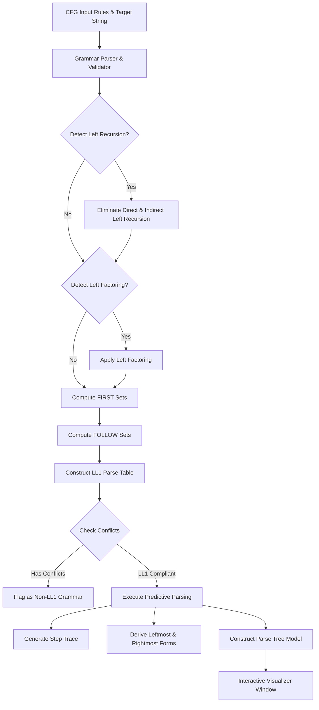

# Grammar Analyzer & Parse Tree Generator GUI

[](https://www.python.org/downloads/)
[](https://docs.python.org/3/library/tkinter.html)
[]()
[]()
[](LICENSE)

An interactive, educational desktop application developed in **Python** and **Tkinter** for comprehensive **Context-Free Grammar (CFG)** analysis, **LL(1)** parsing, and dynamic **Parse Tree visualization**.

Designed for computer science students and educators in **Compiler Design**, this tool automates manual compiler design steps: validating grammars, eliminating direct/indirect left recursion, applying left factoring, computing FIRST and FOLLOW sets, building LL(1) parsing tables, verifying input strings, and generating visual, color-coded parse trees.

---

## 📋 Table of Contents

- [Overview & Abstract](#-overview--abstract)
- [Key Features](#-key-features)
- [Architecture & Workflow](#-architecture--workflow)
- [Project Structure](#-project-structure)
- [Grammar Syntax & Conventions](#-grammar-syntax--conventions)
- [Installation & Getting Started](#-installation--getting-started)
- [Usage Guide & Shortcuts](#-usage-guide--shortcuts)
- [Built-in Sample Grammars](#-built-in-sample-grammars)
- [Parse Tree Visualizer](#-parse-tree-visualizer)
- [Academic Information & Project Team](#-academic-information--project-team)
- [License](#-license)

---

## 📖 Overview & Abstract

Compiler Design is a foundational computer science discipline where understanding grammar transformations, predictive parsing, and syntax tree generation is essential. However, working through these algorithms manually on paper is tedious, error-prone, and difficult to verify.

This project delivers a complete, automated environment for compiler design workflows:
1. **Input & Validate**: Accept custom context-free grammar production rules and target input strings.
2. **Transform**: Detect and eliminate both direct and indirect left recursion; perform iterative left factoring.
3. **Compute Sets**: Calculate FIRST and FOLLOW sets for all non-terminals.
4. **Build Parse Table**: Construct the LL(1) parsing table and identify any grammar conflicts.
5. **Parse & Trace**: Simulate predictive stack parsing with step-by-step traces, computing leftmost and rightmost derivations.
6. **Visualize**: Render a clean, 2D hierarchical parse tree with distinct color coding for non-terminals, terminals, and epsilon symbols.

---

## ✨ Key Features

| Capability | Description |
|---|---|
| **Grammar Validation** | Validates production syntax, identifies undefined non-terminals, flags unreachable symbols, and detects unproductive/useless productions. |
| **Left Recursion Elimination** | Accurately identifies and removes both direct and indirect left recursion using standard textbook algorithms, creating fresh auxiliary non-terminals (`E'`, `T'`). |
| **Left Factoring** | Identifies common prefixes across alternative productions and factors them iteratively. |
| **FIRST & FOLLOW Computation** | Computes complete FIRST and FOLLOW sets, correctly handling epsilon transitions (`#`) and endmarkers (`$`). |
| **LL(1) Table Construction** | Builds the 2D predictive parse table and reports conflicts (`M[A, a]` multiple entries) if the grammar is not LL(1). |
| **Predictive Parsing Engine** | Stack-based LL(1) simulation showing stack contents, remaining input, and exact actions (`Expand`, `Match`, `Accept`, `Reject`). |
| **Derivation Generator** | Generates formatted step-by-step **Leftmost Derivation** and **Rightmost Derivation** sequences. |
| **Interactive Tree Visualizer** | Interactive canvas window featuring zoom in/out, pan, reset, and export to **PNG** with color-coded nodes. |
| **Report Export** | One-click export of full analysis reports into structured text (`.txt`) files. |

---

## 🏗 Architecture & Workflow



---

## 📂 Project Structure

```text
GrammarAnalyzer/
├── assets/                                                # Project assets and media
├── grammar.py                                             # CFG data structures, validation, transformations & sets
├── parser.py                                              # LL(1) table construction, tokenization & stack parser
├── tree.py                                                # TreeNode model for parse tree hierarchy
├── visualizer.py                                          # Tkinter canvas interactive tree visualizer
├── utils.py                                               # Preset samples, table formatting & report generator
├── main.py                                                # Tkinter GUI application entry point
├── requirements.txt                                       # Project dependencies (Pillow for image export)
├── .gitignore                                             # Git ignore configuration
├── KLH-CSE-2026-27-Parse Tree Generator GUI-ABSTRACT.pdf  # Project Abstract Submission document
└── README.md                                              # Comprehensive project documentation
```

### Module Descriptions

- **`main.py`**: Launches the main user interface built with `tkinter` and `ttk`. Connects grammar input, action buttons, real-time status updates, report rendering, and parse tree windows.
- **`grammar.py`**: Defines the `Grammar` class. Contains algorithms for:
  - Lexical tokenization of grammar productions.
  - Reachability and productivity validation.
  - Direct and indirect left recursion detection (`detect_left_recursion`) and elimination (`remove_left_recursion`).
  - Left factoring detection (`detect_left_factoring`) and prefix extraction (`left_factoring`).
  - Nullability analysis and calculation of `FIRST` and `FOLLOW` sets.
- **`parser.py`**: Handles predictive parsing:
  - `build_parse_table`: Builds the $M[A, a]$ parsing table and detects ambiguity/conflicts.
  - `parse_input`: Executes the stack simulation, recording stack states, input buffer, production expansions, and terminal matches.
  - Produces derivations and constructs the hierarchical `TreeNode` representation.
- **`tree.py`**: Provides the lightweight `TreeNode` object used to represent derivation tree nodes and their spatial coordinates ($x, y$).
- **`visualizer.py`**: Provides `ParseTreeWindow`, a dedicated top-level canvas window with:
  - Hierarchical tree layout algorithm.
  - Zoom controls (`+`, `-`, `Reset`).
  - PostScript/PNG export utilizing `Pillow`.
- **`utils.py`**: Contains sample test grammars (`SAMPLES`), formatted ASCII table generation, and textual report export logic.

---

## 🔤 Grammar Syntax & Conventions

When entering production rules in the grammar editor:

- **Arrow**: Use `->` to separate the Left-Hand Side (LHS) and Right-Hand Side (RHS).
- **Alternatives**: Use `|` to separate multiple production options for a non-terminal.
- **Epsilon ($\epsilon$)**: Use `#` to represent epsilon / empty string transitions.
- **Endmarker**: Represented automatically as `$` in the parsing table and stack trace.
- **Non-Terminals**: Typically uppercase letters (e.g., `E`, `T`, `F`, `S`, `A`), or primed versions (`E'`, `T'`).
- **Terminals**: Lowercase letters, numbers, punctuation symbols, or special keywords (e.g., `+`, `*`, `(`, `)`, `id`, `num`).
- **Spacing**: Space-separated symbols (e.g., `E -> T E'`) are fully supported. For compact single-character strings (e.g., `A -> ab | ac`), automatic tokenization is applied.

---

## 🚀 Installation & Getting Started

### Prerequisites

- **Python 3.10** or higher installed on your system.
- `tkinter` (bundled standard with official Python installers on Windows and macOS).

### 1. Clone the Repository

```bash
git clone https://github.com/rgiridhar1008/KLH-CSE-2026-27-2420030171-ParseTreeGeneratorGUI.git
cd KLH-CSE-2026-27-2420030171-ParseTreeGeneratorGUI
```

### 2. (Optional) Set up a Virtual Environment

```bash
# Windows
python -m venv venv
venv\Scripts\activate

# macOS / Linux
python3 -m venv venv
source venv/bin/activate
```

### 3. Install Optional Dependencies

To enable exporting parse trees directly as PNG image files:

```bash
pip install -r requirements.txt
```

*(Note: The core application runs without any third-party packages using the Python standard library).*

### 4. Run the Application

```bash
python main.py
```

---

## 🖥 Usage Guide & Shortcuts

1. **Select or Enter a Grammar**:
   - Choose one of the preset samples from the **Sample** dropdown, or type custom context-free grammar rules directly into the **Grammar Input** text area.
2. **Enter an Input String**:
   - Provide the token string to be tested (e.g., `id+id*id` or `ab`).
3. **Click "Analyze"** (or press `Ctrl + Enter`):
   - The system checks grammar validity.
   - Any left recursion is automatically detected and removed.
   - Any common prefixes are factored.
   - FIRST and FOLLOW sets are calculated.
   - The LL(1) parse table is displayed.
   - The input string is parsed, displaying step-by-step stack actions and derivations.
4. **View Parse Tree**:
   - Click the **Parse Tree** button to open the graphical canvas.
   - Use **Zoom +**, **Zoom -**, and **Reset** to inspect the hierarchy.
   - Click **Save PNG** to save the visualization to your drive.
5. **Export Analysis**:
   - Click **Export TXT** (or press `Ctrl + S`) to save a complete text report of the analysis.

### Keyboard Shortcuts

| Shortcut | Action |
|---|---|
| <kbd>Ctrl</kbd> + <kbd>Enter</kbd> | Run Grammar Analysis & Parsing |
| <kbd>Ctrl</kbd> + <kbd>L</kbd> | Clear all input fields and results |
| <kbd>Ctrl</kbd> + <kbd>S</kbd> | Export complete analysis report as `.txt` |

---

## 🧪 Built-in Sample Grammars

The application comes pre-loaded with standard textbook compiler design examples:

### 1. Arithmetic Expressions (Left Recursive)
```text
E -> E + T | T
T -> T * F | F
F -> ( E ) | id
```
*Input String:* `id+id*id`  
*Automated Action:* Detects direct left recursion in `E` and `T`, transforming them into `E -> T E'`, `E' -> + T E' | #`, `T -> F T'`, `T' -> * F T' | #`.

### 2. Factored LL(1) Expressions
```text
E -> T E'
E' -> + T E' | #
T -> F T'
T' -> * F T' | #
F -> ( E ) | id
```
*Input String:* `id+id*id`  
*Result:* Accepted, with full 17-step predictive parsing trace and derivation trees.

### 3. Left Factoring Example
```text
A -> ab | ac
```
*Input String:* `ab`  
*Automated Action:* Detects common prefix `a` and factors the production into `A -> a A'` and `A' -> b | c`.

---

## 🎨 Parse Tree Visualizer

The graphical parse tree window provides intuitive visual cues:

- 🔵 **Blue Nodes (`#2563eb`)**: Non-terminals (e.g., `E`, `T`, `F`, `E'`).
- 🟢 **Green Nodes (`#16a34a`)**: Terminals (e.g., `id`, `+`, `*`, `(`, `)`).
- ⚪ **Gray Nodes (`#6b7280`)**: Epsilon transitions (`#`).
- **Interactive Controls**: Dynamic scaling and zoom levels to accommodate large derivations.

---

## 👥 Academic Information & Project Team

This project was developed for the **Project Evaluation (24CS2235F)** course in the **Department of Computer Science & Engineering (CSE)** at **KL University (KLH)** for the Academic Year **2026 – 2027**.

### Team Members

| S. No. | University ID | Student Name | Role |
|:---:|:---:|:---|:---|
| 1 | `2420030099` | **B. Srihitha** | Research & Grammar Transformations |
| 2 | `2420030162` | **V. Sai Dhanush** | Parser Implementation & FIRST/FOLLOW |
| 3 | `2420030171` | **R.L.S. Giridhar** | Architecture, GUI & Tree Visualizer |
| 4 | `2420090077` | **D. Krishna Chaitanya** | Testing, Derivations & Documentation |

**Project Guide:**  
**B. Dwarakanath**, Department of Computer Science & Engineering, KL University.

---

## 📄 License

This project is open-source under the [MIT License](LICENSE). Educational use, modifications, and enhancements for academic and compiler design research are welcome.
